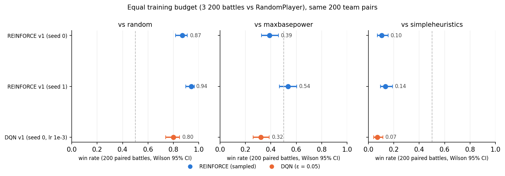

# showdown-rl

Two reinforcement-learning agents for **Gen 9 Random Battles** on [Pokémon Showdown](https://pokemonshowdown.com), implemented by hand in PyTorch without an RL library: a policy-gradient agent (REINFORCE) and a value-based agent (Double DQN). Each was validated on CartPole first, then trained against a local Showdown server and evaluated against three scripted baselines on the same 200 team pairs with Wilson 95% confidence intervals.

> **Who wrote what.** I (Aleks) wrote the RL algorithm code: the returns, advantages and policy-gradient loss for REINFORCE; the Q-network, ε-greedy action selection, replay buffer, ε schedule, Double-DQN target and loss, and target sync for DQN; and the evaluation loop and Wilson interval. Claude Code wrote the environment plumbing (poke-env player classes, observation encoder, action masking, damage-calculator features, evaluation harness, plotting).

## Results in one table

Equal training budget: 200 iterations × 16 battles = 3 200 battles against `RandomPlayer`, seed 0 (and seed 1 for REINFORCE). Evaluation: 200 battles per matchup on one fixed, seeded list of team pairs shared by every row; REINFORCE samples from its policy, DQN acts ε-greedily with ε = 0.05 (its training floor). Each cell is the agent's win rate with its Wilson 95% interval. For scale, the baselines against each other on the same teams: random beats maxbasepower 0.07, random beats simpleheuristics 0.01, maxbasepower beats simpleheuristics 0.115 (measured in the REINFORCE seed 0 run; these move by a few points from run to run because battle randomness is not fixed).

| agent (3 200 battles) | vs RandomPlayer | vs MaxBasePowerPlayer | vs SimpleHeuristicsPlayer |
|---|---|---|---|
| REINFORCE, seed 0 | 0.870 [0.82, 0.91] | 0.390 [0.33, 0.46] | 0.105 [0.07, 0.16] |
| REINFORCE, seed 1 | 0.940 [0.90, 0.97] | 0.535 [0.47, 0.60] | 0.135 [0.09, 0.19] |
| Double DQN, seed 0 (lr 1e-3) | 0.800 [0.74, 0.85] | 0.320 [0.26, 0.39] | 0.070 [0.04, 0.11] |



The other tables (greedy evaluations, the DQN learning-rate check that picked lr 1e-3 over the CartPole-derived 2.5e-4, and the curriculum ablation) are in [`results/comparison.md`](./results/comparison.md). Four more DQN runs are in no table; their evaluation files are in `results/`: 200 more iterations against RandomPlayer from the lr 2.5e-4 model (`eval2_dqn_r400`, 0.78 against random), 200 more against MaxBasePower from that one (`eval2_dqn_c600`, 0.785), 200 more iterations against RandomPlayer from the lr 1e-3 model (`eval2_dqn_lr1e-3_r400`, which collapsed to 0.33), and a run with one gradient step per transition instead of 0.25 (`eval2_dqn_v1_upt1`, which collapsed to 0.275).

On CartPole (one run each), DQN reached a 50-episode mean return of 450 after 614 episodes; REINFORCE needed 2 210 episodes at lr 1e-3 and 650 at lr 3e-3. The check ran after every episode for DQN and after every batch of 10 episodes for REINFORCE.

Overall, both REINFORCE and DQN models managed to beat a Random player fairly easily, though things like length of training, learning rate, seed, curriculum and sampling all impacted their win rates. For the more advanced opponents, none of the models managed to beat them reliably. In order to achieve that, I believe that the most impactful step is to revisit the features and engineer new features which can help the models identify better plays more easily and only then revisit training-specific hyperparameters.

## The problem

A Random Battle is a 6-vs-6 turn-based game with teams generated by the server. From the agent's side it is:

- **Partially observed.** The opponent's moves, item and ability are revealed only when used; the team is revealed one Pokémon at a time.
- **Adversarial and stochastic.** Damage rolls, critical hits, accuracy, and the opponent's choices.
- **A masked discrete action space.** 13 actions per turn (4 moves, 4 Tera moves, 5 switches) and the mask, i.e. which actions are legal, changes every turn.
- **Sparse reward.** 0 every turn, ±1 at the end of a battle for a win or loss respectively. In my training runs a battle took on average between about 25 and 60 decisions by the agent, depending on the opponent and the stage of training.

## Setup

- **Environment.** [`poke-env`](https://github.com/hsahovic/poke-env) 0.15 on a local [Showdown server](https://github.com/smogon/pokemon-showdown); format `gen9randombattle` for training.
- **Observation.** 379 float features plus 12 species IDs fed through an embedding. The features are: weather and terrain, hazards and screens per side, the active Pokémon of both sides (HP, status, stat boosts, types, Tera information), the bench of both sides (HP, status), and a damage-calculator block of 127 numbers. That block holds the predicted damage (minimum, maximum, expected), KO probability and accuracy of each of the agent's moves against the opponent's active Pokémon, the same for the opponent's four most threatening moves against the agent's active Pokémon, coarser versions involving either side's bench, and a speed comparison. The opponent's unrevealed moves, item and ability are filled in from the random-battle set database. Encoder: `src/showdown_rl/state.py`; damage features: `src/showdown_rl/damage.py`, wrapping `poke_env.calc`.
- **Networks.** Species embedding (8-d per slot) concatenated with the features, two hidden layers of 256 with ReLU; then a policy head with masked softmax (REINFORCE, plus an unused value head) or 13 Q-values with illegal actions masked out of the argmax and the target (DQN).
- **Reward.** +1 win, −1 loss, 0 otherwise; γ = 0.99.
- **Baselines** (all from poke-env). `RandomPlayer` picks a random legal action. `MaxBasePowerPlayer` always uses its move with the highest base power. `SimpleHeuristicsPlayer` is a hand-written rule-based player that uses type matchups, damage estimates and switching.

## Method

I trained and compared two different algorithms for the random battles:

**REINFORCE.** The network outputs a probability distribution over the actions; illegal actions are masked. In training we sample from that distribution. At evaluation time we either sample as well or take the argmax (greedy); argmax was clearly better for one of the two seeds and made no difference for the other (table B in [`results/comparison.md`](./results/comparison.md)). The update changes the parameters θ of the model, which in turn changes the probabilities of picking certain actions in given states. What decides the update is the loss function, which uses the discounted future rewards and adds a term for entropy, to encourage exploration and keep the model from simply becoming deterministic:

```
loss = −(1/N) Σ_t log π_θ(a_t | s_t) · Â_t  −  β · (1/N) Σ_t H(π_θ(· | s_t))
```

Here N is the number of decisions in the batch, H is the entropy of the policy in state s_t, and G_t = r_t + γ r_{t+1} + γ² r_{t+2} + … is the discounted future reward from step t on. We do not use G_t directly but the advantage Â_t: we subtract the mean of G_t over the batch and divide by its standard deviation. Subtracting the mean lowers the variance of the gradient estimate, which makes the algorithm more robust, especially in games like CartPole where there is no negative reward; dividing by the standard deviation keeps the size of the update independent of the reward scale. Each batch is used for one update and then thrown away, because the gradient is only valid for data collected with the current policy.

*Settings:* lr 1e-3, γ = 0.99, β = 0.01, one update per iteration of 16 battles, gradient norm clipped at 1.

**Double DQN.** The network estimates Q(s, a), the Q-value of a state-action pair: the expected discounted future reward if you select action a in state s and then play optimally afterwards. These values satisfy the Bellman equation

```
Q(s, a) = E[ r + γ · max_a' Q(s', a') ]
```

where the expectation is over the next state s' and the max is over the legal actions in s'. The regression target comes from this equation. We cannot compute the expectation, so every observed transition (s, a, r, s') gives one sample of the right-hand side, the target y (just y = r if the battle ended), and the network is trained to bring Q(s, a) closer to y with a Huber loss. y is treated as a fixed label: no gradient flows through it.

A replay buffer allows us to reuse past moves and iterations. This helps the model not to "forget" certain things, by showing them to it over and over, and it makes batch updates much easier, because we do not have to sample new data after every weight update (as on-policy learning such as REINFORCE requires); instead we can reuse transitions even if they were collected under earlier policies. Drawing each batch at random from the buffer also breaks up the correlation between consecutive turns of the same battle.

The regression target itself depends on Q-values, hence on our parameters θ, so whenever we update our weights the target changes as well. This moving target can make learning less reliable. To deal with it, we compute the target with a second network, the target network: a frozen copy of our weights that is synced with the "online" network only at much larger intervals. Whenever that happens, we expect a slight uptick in the loss, as the target of the online network changes.

In Double DQN the newer online network, which is improved at every update, picks the action in s', and the target network with its frozen copy of the weights evaluates that action:

```
y = r + γ · Q_target(s', argmax_a' Q_online(s', a'))
```

Taking the max over noisy estimates with a single network tends to overestimate the value. Splitting the choice of the action and its evaluation between the two networks reduces that overestimation.

The agent explores through ε-greedy: with probability ε it picks a random legal action and with probability 1 − ε the best legal action. At the beginning of training ε is 1; in our case it went down to 0.05 and stayed there, to keep some exploration alive for the whole training.

*Settings:* lr 1e-3 (the CartPole-derived 2.5e-4 did worse, table D in [`results/comparison.md`](./results/comparison.md)), γ = 0.99, replay buffer of 50 000 transitions, batch 64, updates start once 1 000 transitions are stored, one gradient step per four collected transitions, target sync every 500 gradient steps, ε from 1 to 0.05 linearly over the first 20 000 decisions, gradient norm clipped at 10.

## Evaluation protocol

Points 1 and 2 were fixed before the first evaluation table existed. Three things were decided later: how DQN acts at evaluation time, the evaluation format, and the DQN learning rate of the headline row.

1. Three baselines, 200 battles each, Wilson 95% intervals.
2. **Paired teams.** One seeded list of 200 (own, opponent) random-battle team pairs is generated once with Showdown's own generator and cached; every row of every table plays that list in order. Battle randomness is not fixed.
3. Agents are evaluated as the behaviour policy they trained with (REINFORCE samples, DQN ε = 0.05). Greedy rows (argmax / ε = 0) are reported separately.
4. Battles run in `gen9anythinggoes` with the team validator disabled and Sleep Clause added, because the random format ignores supplied teams and the custom-game format reports exact opponent HP, which rescales the damage features relative to training (found on 2026-10-08). Every table in this README and in `results/comparison.md` was measured after the fix; the `results/eval_*.csv` files and `results/curriculum.md` are the earlier measurements, kept as the record.

## Ablation: curriculum vs from scratch

Both agents were continued from their equal-budget checkpoint for 200 iterations against MaxBasePower and then 200 against SimpleHeuristics, and REINFORCE was also trained from scratch against each stronger opponent. The table and the reading are in [`results/comparison.md`](./results/comparison.md), section C.

## Design decisions

- **poke-env over a hand-rolled protocol client** and **one format, Gen 9 Random Battles**: the environment is not the project.
- **Damage features from `poke_env.calc`, not a from-scratch formula**: the calculator is the domain knowledge; the agent learns what to do with it.
- **Flat 13-action MLP with masking** rather than a pointer network: enough for the question asked.
- **REINFORCE then DQN, each validated on CartPole first**: two algorithm families.
- **Paired-team evaluation with Wilson intervals**: every row on the same 200 team pairs, so differences between rows are not team luck.
- **DQN evaluated ε-greedy in the protocol row**: compare behaviour policies; greedy rows shown separately.
- **Evaluation format fix**: the custom-game format is a debug format and reports exact HP; the damage features divide by the opponent's displayed max HP, which is 100 in training. Switching the evaluation format restored the training-time observation scale. The same DQN checkpoint scored 0.54 and 0.595 against RandomPlayer before the fix and 0.695 after; REINFORCE went from 0.300 to 0.390 against MaxBasePower.
- **Curriculum as the ablation**: random → maxbasepower → simpleheuristics vs scratch, same battle budget.

## Limitations

- I only used one or sometimes two seeds for training (two for REINFORCE, one for DQN) and one fixed team list for evaluation. To get more reliable results, I would have to rerun the training and testing with more, different seeds. Especially the testing: currently it is a fixed sequence of 200 team matchups and every model gets the same sequence. 200 battles might not be enough to remove the noise that comes from the models, or their opponents, having a team advantage on average.
- We tuned very little: for DQN only the learning rate (two values) and the number of gradient steps per transition (two values), one seed each; for REINFORCE nothing on Showdown; and not the network size. A larger neural network could offer a lot of room for improvement.
- The DQN learning rate of the headline row was picked by its result on the same 200 team pairs it is reported on, so that row is slightly favoured.
- The agents only ever trained against fixed scripted opponents; there is no self-play. No agent beats SimpleHeuristics: the best win rate against it in any table is 0.18.
- The damage features against the opponent are damage in HP points divided by 100, not by the opponent's actual maximum HP, so they are not true fractions of its health. This is the same in training and in evaluation.

## Reproduce

```bash
# one-time
uv sync --extra rl --extra dev --extra plot
git clone https://github.com/smogon/pokemon-showdown external/pokemon-showdown
(cd external/pokemon-showdown && npm install)

# tests (two integration tests need the server)
.venv/bin/python -m pytest

# server, in a second terminal
node external/pokemon-showdown/pokemon-showdown start --no-security

# CartPole checks
.venv/bin/python scripts/cartpole_reinforce.py
.venv/bin/python scripts/cartpole_dqn.py

# Showdown, equal budget (tens of minutes each on a laptop)
.venv/bin/python -m showdown_rl.train_reinforce --iters 200 --battles-per-iter 16 --seed 0 --stem reinforce_showdown_v1
.venv/bin/python -m showdown_rl.train_dqn       --iters 200 --battles-per-iter 16 --seed 0 --lr 1e-3 --stem dqn_showdown_v1_lr1e-3

# evaluation (≈5 min per table; --greedy / --eps 0 for the argmax rows)
.venv/bin/python -m showdown_rl.evaluate --checkpoint results/reinforce_showdown_v1_policy.pt --out results/eval2_reinforce_v1.csv
.venv/bin/python -m showdown_rl.evaluate --algo dqn --checkpoint results/dqn_showdown_v1_lr1e-3_qnet.pt --out results/eval2_dqn_v1_lr1e-3.csv

# assemble the comparison table and plot
.venv/bin/python scripts/make_comparison.py
```

The numbers will not reproduce exactly: the training seed fixes the network initialisation and the agent's sampling during training, and the evaluation seed fixes the team list, but the server's battle randomness and the agent's sampling at evaluation time are not seeded. The results here were produced with Showdown commit `6a28659` (May 2026). Model checkpoints (`*.pt`) are not in the repository.

## Repository

```
src/showdown_rl/   actions.py (13-action space + mask)  state.py (observation)  damage.py (calc features)  sets.py (set database)
                   policy.py (REINFORCE network)  agent.py (poke-env Player)  train_reinforce.py  train_dqn.py  evaluate.py
scripts/           cartpole_reinforce.py  cartpole_dqn.py  make_comparison.py  plot_curriculum.py
results/           eval2_*.csv (tables)  *_curve.{csv,png} (training curves)  comparison.{csv,md,png}  curriculum.md (earlier measurements)
tests/             98 unit tests + 2 server integration tests
```
