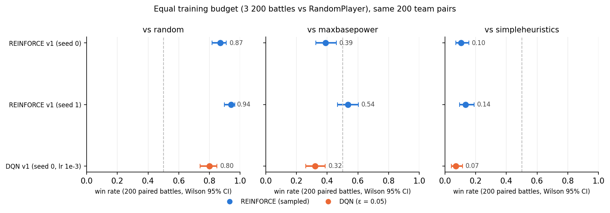

# REINFORCE vs Double DQN on Gen 9 Random Battles

Every number below: 200 battles per matchup on the same seeded list of 200 team pairs, Wilson 95% interval in brackets, the fixed evaluation format (README, evaluation protocol, point 4; all tables re-measured after the 2026-10-08 fix). Training budget is counted in battles; one iteration = 16 battles. "sampled" = actions drawn from the REINFORCE policy; "eps 0.05" = DQN ε-greedy at its training floor; "argmax" / "eps 0" = deterministic. Baselines on the same teams: random beats maxbasepower 0.04–0.095, random beats simpleheuristics 0.00–0.025, maxbasepower beats simpleheuristics 0.07–0.155 across the runs in these tables (battle randomness only; teams are fixed).

Source files: `results/eval2_*.csv`; assembled by `scripts/make_comparison.py` into `comparison.csv` and `comparison.png`.

## Tables

<!-- TABLES:START -->
**A. Equal budget, behaviour policies (the headline comparison)**

| checkpoint | battles | eval policy | vs random | vs maxbasepower | vs simpleheuristics |
|---|---|---|---|---|---|
| REINFORCE v1 (seed 0) | 3200 | sampled | 0.870 [0.82, 0.91] | 0.390 [0.33, 0.46] | 0.105 [0.07, 0.16] |
| REINFORCE v1 (seed 1) | 3200 | sampled | 0.940 [0.90, 0.97] | 0.535 [0.47, 0.60] | 0.135 [0.09, 0.19] |
| DQN v1 (seed 0, lr 1e-3) | 3200 | eps 0.05 | 0.800 [0.74, 0.85] | 0.320 [0.26, 0.39] | 0.070 [0.04, 0.11] |

**B. Same checkpoints, deterministic policies (argmax / ε = 0)**

| checkpoint | battles | eval policy | vs random | vs maxbasepower | vs simpleheuristics |
|---|---|---|---|---|---|
| REINFORCE v1 (seed 0) | 3200 | argmax | 0.955 [0.92, 0.98] | 0.545 [0.48, 0.61] | 0.180 [0.13, 0.24] |
| REINFORCE v1 (seed 1) | 3200 | argmax | 0.940 [0.90, 0.97] | 0.515 [0.45, 0.58] | 0.145 [0.10, 0.20] |
| DQN v1 (seed 0, lr 1e-3) | 3200 | eps 0 | 0.840 [0.78, 0.88] | 0.375 [0.31, 0.44] | 0.075 [0.05, 0.12] |

**C. Curriculum vs scratch: both algorithms continued from their v1 checkpoint in A (REINFORCE rows are the checkpoints of the earlier curriculum experiment, re-evaluated in the fixed evaluation format)**

| checkpoint | battles | eval policy | vs random | vs maxbasepower | vs simpleheuristics |
|---|---|---|---|---|---|
| REINFORCE c400 (v1 +200 it vs maxbasepower) | 6400 | sampled | 0.930 [0.89, 0.96] | 0.550 [0.48, 0.62] | 0.155 [0.11, 0.21] |
| DQN c400 (v1 +200 it vs maxbasepower, lr 2.5e-4) | 6400 | eps 0.05 | 0.810 [0.75, 0.86] | 0.250 [0.20, 0.31] | 0.070 [0.04, 0.11] |
| REINFORCE c600 (c400 +200 it vs simpleheuristics) | 9600 | sampled | 0.930 [0.89, 0.96] | 0.545 [0.48, 0.61] | 0.180 [0.13, 0.24] |
| DQN c600 (c400 +200 it vs simpleheuristics, lr 2.5e-4) | 9600 | eps 0.05 | 0.675 [0.61, 0.74] | 0.170 [0.12, 0.23] | 0.015 [0.01, 0.04] |
| REINFORCE smbp (200 it vs maxbasepower, from scratch) | 3200 | sampled | 0.920 [0.87, 0.95] | 0.455 [0.39, 0.52] | 0.090 [0.06, 0.14] |
| REINFORCE s200 (200 it vs simpleheuristics, from scratch) | 3200 | sampled | 0.160 [0.12, 0.22] | 0.030 [0.01, 0.06] | 0.005 [0.00, 0.03] |
| REINFORCE s400 (400 it vs simpleheuristics, from scratch) | 6400 | sampled | 0.140 [0.10, 0.19] | 0.015 [0.01, 0.04] | 0.000 [0.00, 0.02] |
| REINFORCE s600 (600 it vs simpleheuristics, from scratch) | 9600 | sampled | 0.685 [0.62, 0.75] | 0.255 [0.20, 0.32] | 0.060 [0.03, 0.10] |

**D. DQN training parameters: CartPole-derived learning rate vs lr 1e-3 (same budget, same seed)**

| checkpoint | battles | eval policy | vs random | vs maxbasepower | vs simpleheuristics |
|---|---|---|---|---|---|
| DQN lr 2.5e-4 (CartPole settings) | 3200 | eps 0.05 | 0.695 [0.63, 0.75] | 0.175 [0.13, 0.23] | 0.025 [0.01, 0.06] |
| DQN lr 1e-3 (= DQN v1 in A) | 3200 | eps 0.05 | 0.800 [0.74, 0.85] | 0.320 [0.26, 0.39] | 0.070 [0.04, 0.11] |
| DQN lr 2.5e-4 (CartPole settings) | 3200 | eps 0 | 0.695 [0.63, 0.75] | 0.230 [0.18, 0.29] | 0.015 [0.01, 0.04] |
| DQN lr 1e-3 (= DQN v1 in A) | 3200 | eps 0 | 0.840 [0.78, 0.88] | 0.375 [0.31, 0.44] | 0.075 [0.05, 0.12] |
<!-- TABLES:END -->

## Readings (Aleks)

### A. Equal budget

Both REINFORCE and DQN beat the random opponent (lower bounds of all CIs are larger than 0.5), however REINFORCE has the higher win rate against all three opponents. For seed 0 the intervals overlap with DQN's everywhere; for seed 1 they are separated against the Random and the Max Base Power Player.

At first, I used the same learning rate for DQN as for the CartPole game (2.5e-4), but I quickly realized that by switching to 1e-3 model performance improved a lot. I used the second learning rate for the comparisons in A and B and I use the CartPole learning rate for the posttraining steps in C. I compare the two learning rates in D.  

### B. Deterministic policies

I also tried removing all the randomness from the algorithms to see whether they would perform better, if they only played the action they predicted to be the best one in each turn. For REINFORCE this meant using the action with the highest softmax value instead of sampling from the softmax distribution and for DQN I just set the exploration parameter epsilon to 0, meaning the algorithm was acting greedily.

The results showed a significant improvement for REINFORCE on seed 0 (0.87 → 0.955 against Random, 0.39 → 0.545 against MaxBasePower) but no change for seed 1, despite seed 1's higher final entropy (1.17 vs 1.06 nats). 
I am mentioning the entropy here, because I thought that a higher entropy meant that the algorithm played more different actions (less deterministic), which meant that it played suboptimal actions more often and that by having it act greedily it would improve by more. However, this was not the case, at least not in this tiny sample of two seeds. The observation could also just be seed-specific.

For DQN changing epsilon from 0.05 to 0 also gave slightly higher win rates, but the differences are well within the intervals.

With this change, both REINFORCE seeds significantly outperformed DQN against the random opponent and the Max Base Power Player as there was no overlap between their CIs.

In conclusion, turning off sampling and setting the exploration rate to 0 might be beneficial for the performance of REINFORCE and DQN respectively, though more evaluation still needs to be done.

### C. Curriculum vs scratch (both algorithms)

After having seen that both models could reliably beat the random opponent, I wanted to see how they would perform against stronger opponents. To check that I took the models which had already trained against the random opponent and trained them first for an additional 200 iterations against the Max Base Power Player and then an additional 200 iterations against the Simple Heuristics Player.

Here, REINFORCE again performed significantly better than DQN after the first and second post-training, with one exception: against the Simple Heuristics Player after the first step the two intervals overlap slightly. Note that I used sampling when evaluating REINFORCE and an exploration parameter of 0.05 when evaluating DQN. Considering the observations in B (where switching to a pure greedy policy benefitted REINFORCE more than DQN, at least for seed 0), the gap might be even bigger than seen in the table. Note that for DQN, I started from the stronger model which was trained on lr 1e-3, but still used the old learning rate of 2.5e-4 for the post-training.

I also tried training REINFORCE models against the more difficult opponents from scratch to see whether the curriculum, that is, starting training against a weak opponent (random player) and gradually moving up in difficulty, impacted model performance. After being trained against the Max Base Power Player from scratch for 200 iterations, REINFORCE performed about the same as after being trained against the Random Player for 200 iterations (all differences to the two seeds in A are within the confidence intervals). Against the Simple Heuristics Opponent (most difficult) the table shows that the models were very bad and had very low win rates after 200 and 400 iterations respectively. It recovered after 600 iterations and showed significant improvement, but it was still worse than the curriculum training. This suggests that starting out training against weaker opponents was beneficial to the performance of the final model.

### D. Changing the training parameters (DQN learning rate)

As mentioned earlier, I started out with the cartpole learning rate for DQN, but, as the table shows, the new learning rate had much better performance when setting exploration to 0, which is why I used it for the headline comparisons of DQN with REINFORCE. 

## What a reader should take away

Overall, both REINFORCE and DQN models managed to beat a Random player fairly easily, though things like length of training, learning rate, seed, curriculum and sampling all impacted their win rates. For the more advanced opponents, none of the models managed to beat them reliably. In order to achieve that, I believe that the most impactful step is to revisit the features and engineer new features which can help the models identify better plays more easily and only then revisit training-specific hyperparameters.
