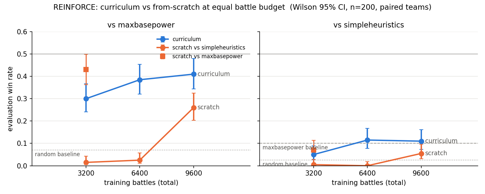

# Curriculum vs from-scratch training (REINFORCE), earlier measurement

> **Superseded numbers.** This writeup is from 2026-09-23. Its table was measured in the old evaluation format, which mis-scaled the damage features (see the README, evaluation protocol, point 4). The same checkpoints re-measured in the fixed format are in [`comparison.md`](./comparison.md), table C. This file is kept as the record.

**Question (Aleks):** does a policy learn to beat SimpleHeuristics faster if it climbs random → maxbasepower → simpleheuristics (each stage initialised from the previous checkpoint) than if it trains against simpleheuristics from scratch, at the same battle budget?

## Setup

- Algorithm: REINFORCE with batch-mean baseline and std-normalised advantages, entropy bonus 0.01, lr 1e-3, γ 0.99, 16 battles per iteration, seed 0. Reward is 0 every turn and ±1 at the end of the battle.
- **Arm C (curriculum):** 200 iters vs random (v1) → 200 iters vs maxbasepower from v1 (c400) → 200 iters vs simpleheuristics from c400 (c600).
- **Arm S (scratch):** 600 iters vs simpleheuristics from a fresh policy, checkpoints at 200 / 400 / 600 (s200, s400, s600).
- Extra: 200 iters vs maxbasepower from scratch (smbp), for comparison with c400.
- Evaluation: `evaluate.py`, 200 battles per matchup, **the same seeded list of 200 team pairs for every row** (paired), actions sampled from the policy, Wilson 95% intervals.
- One seed per arm. No claim about variance across seeds is made.
- Wall time: 200 iterations ≈ 15 min vs maxbasepower, < 5 min vs simpleheuristics (losing battles are short).

## Results

Evaluation win rate, Wilson 95% interval in brackets. Rows are checkpoints, ordered by total training battles.

| checkpoint | training battles | vs random | vs maxbasepower | vs simpleheuristics |
|---|---|---|---|---|
| v1 (C, 200 it) | 3 200 | 0.885 [0.83, 0.92] | 0.300 [0.24, 0.37] | 0.050 [0.03, 0.09] |
| c400 (C) | 6 400 | 0.890 [0.84, 0.93] | 0.385 [0.32, 0.45] | 0.115 [0.08, 0.17] |
| c600 (C) | 9 600 | 0.915 [0.87, 0.95] | 0.410 [0.34, 0.48] | 0.110 [0.07, 0.16] |
| s200 (S) | 3 200 | 0.195 [0.15, 0.26] | 0.015 [0.01, 0.04] | 0.005 [0.00, 0.03] |
| s400 (S) | 6 400 | 0.170 [0.12, 0.23] | 0.025 [0.01, 0.06] | 0.000 [0.00, 0.02] |
| s600 (S) | 9 600 | 0.700 [0.63, 0.76] | 0.260 [0.20, 0.32] | 0.055 [0.03, 0.10] |
| smbp (scratch vs mbp, 200 it) | 3 200 | 0.875 [0.82, 0.91] | 0.430 [0.36, 0.50] | 0.070 [0.04, 0.11] |

Baselines on the same team list: random vs maxbasepower 0.07, random vs simpleheuristics 0.025, maxbasepower vs simpleheuristics 0.10.

Left panel: win rate vs maxbasepower against total training battles. Right panel: the same vs simpleheuristics. Blue = curriculum arm, orange = scratch arm; the orange square is the scratch-vs-maxbasepower run. Dotted and dashed lines are the random and maxbasepower baselines. Source: `scripts/plot_curriculum.py`, data in `reinforce_showdown_curriculum.csv`.

Training-curve facts (win rate against the *training* opponent, windowed; entropy; mean battle length):

| run | opponent | win rate start → end | entropy start → end | battle length |
|---|---|---|---|---|
| c400 | maxbasepower | 0.40 → 0.58, no trend | ~1.1 flat | 28 turns |
| smbp | maxbasepower | 0.07 → 0.45, monotone | ~1.25 flat | 31 turns |
| c600 | simpleheuristics | 0.14 → 0.20 | 0.9 → 0.7 | 25 turns |
| s | simpleheuristics | 0.00 → 0.02 over 500 iters, 0.04 at the end | 1.66 → 0.12 | 28 → 36 turns |

## Interpretation (Aleks)

As seen in the tables above, the curriculum learner performs better than the learner which learned from scratch against simple heuristics across all opponents. However, interestingly, the scratch learner against Max Basepower showed a similar performance after only 200 iterations (as the curriculum learner after 600) against the three different opponents: It even had a slightly better win rate against the maxbasepower opponent (although the CIs still overlap significantly) and its performance against the simple heuristics opponent was not far off either, although it never played against it in training.

Interestingly, the simpleheuristics learner played very badly (at least for the first 400 iterations) against the random player. Looking at the data, we can see that the entropy became very small and the average turn length of the battles increased by a lot. My suspicion is that the learner learned to prolong the battle by as much as possible. The reward for losing a battle is -1 and future rewards are being discounted with some gamma < 1. So, if a learner expects to lose or does not see a clear or likely path to victory, then the optimal play with respect to the loss function is to just delay the loss by as much as possible. It makes sense that this happened against the best opponent as well, because there it was the most difficult to actually win a game, so delaying the loss was more optimal (at least in the beginning). This effect was likely exacerbated by the fact that we subtracted the mean returns as baseline and then divided by the standard deviation of the mean returns. In our case, where most of the battles were lost, that means we added roughly 0.7 to the rewards, but more importantly we divided by the standard deviation, which was very small, and hence our updates became unit length although the signal (return - baseline) was much smaller. This meant the policy got updated regularly by a lot, but that did not improve the performance of the learner significantly (when it came to win rate).

Since we provide expected damage of a move against the opponent as a feature, it would be very easy for the learner to just become a maxbasepower player. It would be interesting to analyze further, whether that is the case. To do that, we could either check the percentage of turns, in which our learner plays the move with the highest expected power, or alternatively, what its win rate against the actual max base power player is. If they are the same, then that should be around 50%, however our evaluations gave us CIs, which were below 0.5 for all our learners, except for the learner actually trained on the max base power player, where 0.5 is exactly the upper bound of the confidence interval.

## Limitations

- One seed per arm; differences of a few points between checkpoints are within seed noise.
- Equal budget in *iterations*, not in *turns*: losing battles against simpleheuristics are short, so Arm S saw fewer decisions per iteration than Arm C.
- Per-battle outcomes are not stored, so the paired design is not yet used for a paired test.
